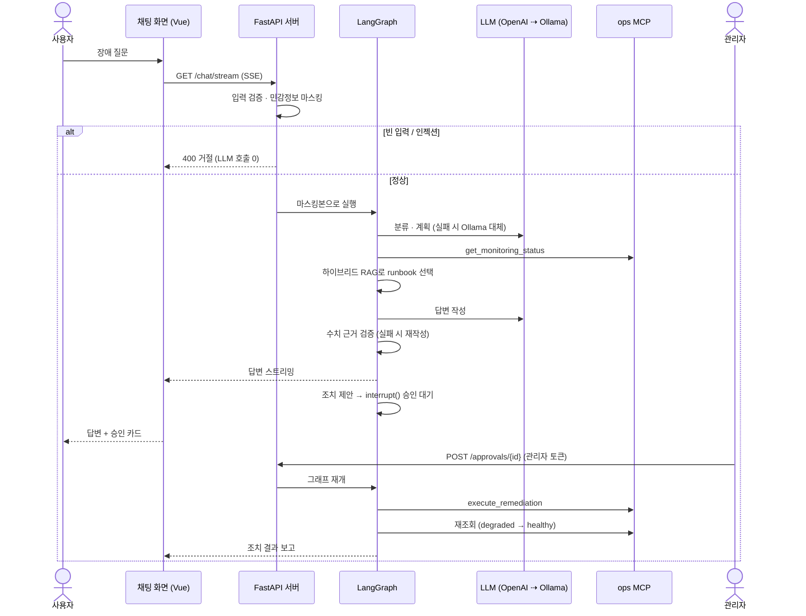
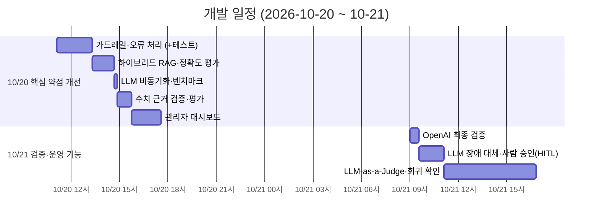
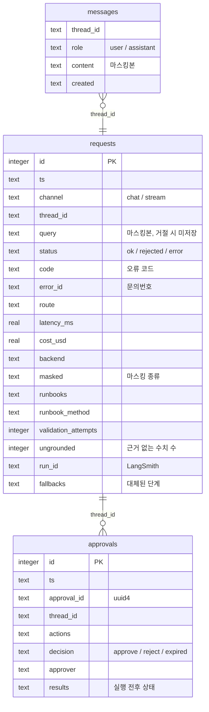
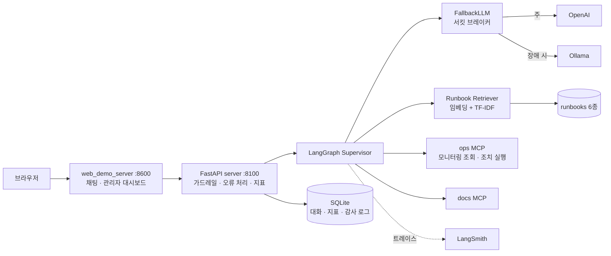
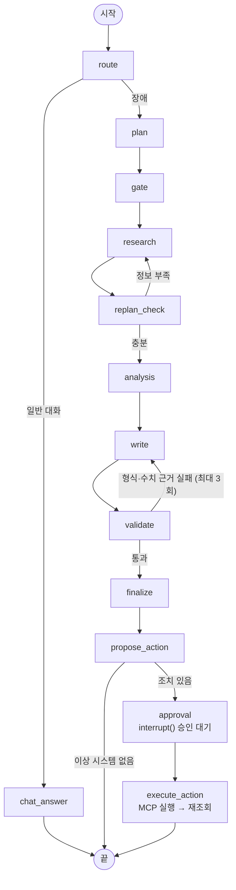
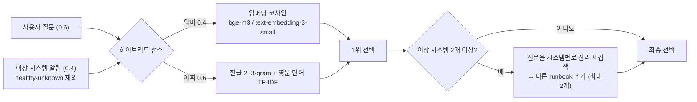
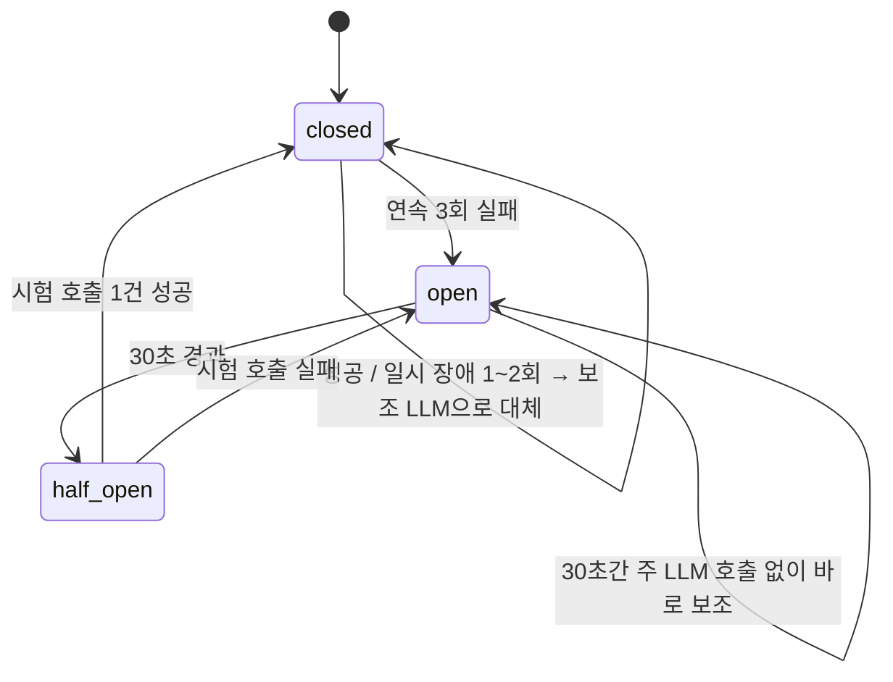

# 운영 인시던트 대응 AI 에이전트 — 상용 서비스 수준 개선

> SKALA AI Mini-Project · 과제 1번(Base AI Agent 개선) · 개인 프로젝트

배포받은 `all_total_vue`(LangGraph + MCP + FastAPI + Vue 기반 운영 장애 진단 에이전트)를
**"실제로 서비스할 수 있는가"** 라는 기준으로 점검하고, 찾아낸 약점 6가지를 고친 뒤
운영 기능 2가지(LLM 장애 자동 대체, 사람 승인 후 조치 실행)를 더했습니다.
모든 개선은 **같은 입력으로 개선 전/후를 실측**했고, 개선 전 동작은 환경변수 하나로 재현할 수 있습니다.

---

## 1. 목표와 기능

### 1.1 목표
- 원본 에이전트를 직접 실행해 **실제로 확인한 약점**만 고친다 (추측성 기능 추가 X)
- 개선마다 **Before/After를 숫자로** 남기고, 개선 전 동작을 환경변수로 재현 가능하게 한다
- 장애 대응 에이전트답게 **LLM이 장애일 때도 동작**하고, 조치 실행은 **사람이 승인**해야만 일어나게 한다
- 개선이 새로 만든 약점까지 숨기지 않고 기록한다 (→ [9. 한계와 개선 방향](#9-한계와-개선-방향))

### 1.2 기능 (개선 8가지)

| # | 구분 | 무엇을 바꿨나 | 핵심 결과 (Before → After) | 개선 전 재현 |
|---|---|---|---|---|
| 1 | 추가 | **입력 가드레일** — 민감정보 마스킹, 빈 입력·프롬프트 인젝션 사전 차단 | 비밀번호·IP가 LLM·DB로 **그대로 전달 → 마스킹본만 전달** | – |
| 2 | 개선 | **오류 처리 표준화** — 내부 오류 비노출, 문의번호로 로그 추적 | `Internal Server Error` / 스트림 무응답 → **안내 문구 + 문의번호** | – |
| 3 | 개선 | **Runbook 선택: 키워드 규칙 → 하이브리드 RAG** | 정답 runbook 포함률 **33% → 94%** (18문항) | `RUNBOOK_RETRIEVER=keyword` |
| 4 | 개선 | **LLM 호출 동기 → 비동기** | 동시 3건 **18.9s → 6.8s**, 처리 중 `/health` **1917ms → 3ms** | `LLM_HTTP_MODE=sync` |
| 5 | 개선 | **답변 수치 근거 검증** — 수집 데이터에 없는 숫자 반려·재작성·경고 | 조작 재현 시 근거 없는 수치 **4/4 → 0/4**, 정상 답변 추가 비용 **0** | `GROUNDING_CHECK=off` |
| 6 | 추가 | **관리자 대시보드** — 토큰 인증, 성공률·지연·비용·오류·마스킹 현황 | 운영 지표 확인 수단 **없음 → 실시간 화면** | – |
| 7 | 추가 | **LLM 장애 자동 대체** — OpenAI 장애 시 Ollama로 전환 + 서킷 브레이커 | OpenAI 장애 중 성공 **0/6 → 6/6**, 평균 응답 5.4s(대체만) → **2.9s**(브레이커) | `LLM_FALLBACK=off` |
| 8 | 추가 | **조치 실행 전 사람 승인 (HITL)** — 제안 → `interrupt()` 승인 대기 → MCP로 실행 → 재조회 | 조치는 글로만 안내 → **승인 시 실행·정상화 확인** (`degraded → healthy`), 승인 없이 실행 **0건** | `REMEDIATION=off` |

**답변 품질 (LLM-as-a-Judge, 18문항)**: 질문 적합성 3.83 → **4.28**, 실행 가능성 4.06 → **4.50**,
블라인드 쌍대 비교 개선 **7승** · 원본 2승 · 무 9 (→ [7-9](#7-9-답변-품질--llm-as-a-judge))

단위 테스트 **82개** (`tests/`), 평가·벤치마크 스크립트 7종 (`eval/`, `bench/`, `sh/`)

### 1.3 팀 구성
- 개인 프로젝트 (기획 · 백엔드 · 프론트 수정 · 평가 전부 1인)

---

## 2. 개발 환경 및 실행

### 2.1 개발 환경

| 구분 | 사용 기술 |
|---|---|
| 언어 | Python 3.11 |
| 에이전트 | LangGraph 1.x (`interrupt()` + `InMemorySaver` 체크포인터), LangChain Core |
| 도구 서버 | FastMCP 3.x — ops MCP(모니터링 조회·조치 실행), docs MCP(API 문서) |
| 백엔드 | FastAPI + Uvicorn (`:8100`), SSE 스트리밍, 비동기 `httpx` |
| 프론트 | Vue 3 (CDN, 빌드 없음) 채팅 화면 + 관리자 대시보드, 데모 서버 (`:8600`) |
| LLM | OpenAI gpt-4o / gpt-4o-mini, 로컬 Ollama qwen3:8b · 0.6b, 결정론 fake |
| 임베딩 | Ollama bge-m3 / OpenAI text-embedding-3-small |
| 저장소 | SQLite (`session.db` — 대화·지표·승인 감사 로그) |
| 관측 | LangSmith 트레이스 |

### 2.2 실행 방법

원본과 동일하게 `bash sh/setup_venv.sh` → `bash sh/setup_ollama.sh` → 서버 → 프론트 순서입니다
(원본 설명은 [doc/README.md](doc/README.md)). 추가된 것:

```bash
cp .env.example .env            # OPENAI_API_KEY, LANGCHAIN_API_KEY, ADMIN_TOKEN 입력
ollama pull bge-m3              # 하이브리드 RAG용 다국어 임베딩 모델

bash sh/run_agent_ollma.sh      # 백엔드 (로컬)  — 또는 sh/run_agent_openai.sh (과금)
bash sh/run_frontend.sh         # http://localhost:8600 채팅, http://localhost:8600/admin 대시보드
```

| 명령 | 내용 |
|---|---|
| `python -m pytest tests -q` | 단위 테스트 82개 |
| `python eval/runbook_eval.py [--sweep]` | runbook 정확도 keyword/어휘/하이브리드 비교, 의미 비중 탐색 |
| `bash sh/run_bench.sh` | 동기 vs 비동기 동시성 벤치마크 (가짜 LLM, 과금 없음) |
| `python eval/grounding_eval.py [--limit N]` | 수치 근거 검증 off/on 비교 |
| `python bench/fallback_bench.py` | LLM 장애 자동 대체 Before/After (가짜 OpenAI 장애 주입, 과금 없음) |
| `LLM_BACKEND=openai python eval/judge_eval.py [--limit N]` | LLM-as-a-Judge 원본/개선 답변 품질 비교 (과금 약 $0.1) |
| `python eval/regression_check.py` | 실행 중인 서버(8100)에 원본 회귀 쿼리 10개 실행 |
| `bash sh/verify_openai.sh` | **OpenAI 최종 검증** — 테스트·정확도·대표 시나리오·관리자 지표·근거 검증 일괄 실행 (과금) |

**개선 전 동작 재현 / 설정 환경변수**

| 변수 | 값 | 효과 |
|---|---|---|
| `RUNBOOK_RETRIEVER` | `keyword` | 원본 키워드 규칙으로 runbook 선택 |
| `LLM_HTTP_MODE` | `sync` | 원본처럼 동기 HTTP 호출 |
| `GROUNDING_CHECK` | `off` | 형식만 검사 |
| `RUNBOOK_SEMANTIC_WEIGHT` | `0.0~1.0` | 의미 점수 비중 (기본 0.4) |
| `EMBED_BACKEND` | `ollama`/`openai`/`none` | 임베딩 제공자 (기본: LLM 백엔드를 따름) |
| `LLM_FALLBACK` | `ollama`/`off` | OpenAI 장애 시 Ollama 대체 (기본 `ollama`, `LLM_BACKEND=openai`일 때만) |
| `LLM_CB_THRESHOLD` / `LLM_CB_COOLDOWN` | `3` / `30` | 브레이커가 열리는 연속 실패 수 / 차단 시간(초) |
| `OPENAI_TIMEOUT` | `120` | OpenAI 호출 타임아웃(초) — 대체 사용 시 짧게 권장 |
| `REMEDIATION` | `on`/`off` | 조치 제안·승인 단계 |
| `APPROVAL_TTL` / `REMEDIATION_TTL` | `600` / `600` | 승인 만료(초) / 시뮬레이션 조치 효과 유지(초) |

### 2.3 API 구조

백엔드 `server.py` (`:8100`). 프론트 데모 서버(`:8600`)는 같은 경로를 중계하고 `/`(채팅), `/admin`(대시보드) 화면을 제공합니다.

| Method | URL | 설명 | 관리자 토큰 | 비고 |
|---|---|---|:-:|---|
| GET | `/health` | 헬스 체크 | | 비동기화 효과 측정 지표 |
| GET | `/version` | 백엔드·모델·설정 정보 | | |
| POST | `/chat` | 질문 → 답변 (일괄) | | 가드레일 통과 후 그래프 실행 |
| GET | `/chat/stream` | 질문 → 답변 (SSE 스트리밍) | | 실패도 200 + `Error` 이벤트로 전달 |
| GET | `/approvals` | 승인 대기 중인 조치 목록 | ✅ | 신규 |
| POST | `/approvals/{approval_id}` | 조치 승인 / 거부 | ✅ | 신규, 중복 409 · 없음 404 |
| GET | `/admin/metrics` | 운영 지표 집계 | ✅ | 신규 |
| GET | `/admin/requests` | 최근 요청 목록 (마스킹본) | ✅ | 신규 |

| MCP Tool | 서버 | 설명 |
|---|---|---|
| `get_monitoring_status` | `mcp_server.py` | 시스템 상태·지표·알림 조회 (원본) |
| `execute_remediation` | `mcp_server.py` | **신규** — 허용 목록 4종 조치만, 승인 번호 검사 후 실행(시뮬레이션) |
| `get_api_doc` | `mcp_server_docs.py` | API 문서 조회 (원본) |

---

## 3. 요구사항 — 원본에서 실제로 확인한 약점

원본을 fake/OpenAI(키 없음) 백엔드로 직접 실행해 확인한 문제가 그대로 요구사항이 됐습니다.

| 확인한 문제 | 재현 방법 | 영향 | → 개선 |
|---|---|---|---|
| "비번 hunter2, IP 10.0.0.5" 입력이 마스킹 없이 LLM으로 전달되고 `session.db`에 원문 저장 | 질문 후 DB 조회 | 외부 LLM 서버·로컬 DB에 민감정보 잔존 | 1 |
| 빈 메시지·인젝션 문구도 LLM 호출 | 공백 전송 | 불필요한 과금 | 1 |
| API 키 누락·요금 한도 시 `Internal Server Error` / 스트림 무응답 | 키 없이 실행 | 사용자는 원인도 다음 행동도 모름 | 2 |
| runbook을 **알림 문구의 키워드 규칙 순서**로 하나만 고름 | "web-01 디스크가 꽉 찼어요" → `db-down` | 사용자 질문이 무시되고, 복합 장애는 한쪽 runbook 누락 | 3 |
| `async def` 노드 안에서 **동기 `httpx.post`** 호출 | 코드 확인 + 벤치마크 | LLM 응답을 기다리는 동안 서버 전체 정지 | 4 |
| validate가 "30자 이상 + `1)` 포함"만 검사 | 코드 확인 (원본 주석에 "CPU 53.5% 조작" 실측 사례 기록) | 그럴듯한 거짓 숫자를 막지 못함 | 5 |
| 관리자가 볼 수 있는 운영 화면 없음 (LangSmith 트레이스뿐) | – | 서비스 전체 상태 파악 불가 | 6 |
| OpenAI 장애(5xx·429·네트워크) 시 모든 요청 실패 | 가짜 OpenAI에 503 주입 | **장애 대응 에이전트가 장애 상황에서 멈춤** | 7 |
| 에이전트는 조치를 글로 안내하는 데서 끝남 | – | 대응 시간이 사람 손에 달림. 반대로 자동 실행은 LLM 오판이 곧 운영 사고 | 8 |

### 3.1 요청 처리 흐름 (개선 후)



---

## 4. 프로젝트 구조와 개발 일정

### 4.1 프로젝트 구조

```
📦all_total_vue_student
 ┣ 📂agent
 ┃ ┣ 📜graph.py               LangGraph 그래프 — runbook 선택·validate·finalize 확장, 조치 제안·승인·실행 노드 (수정)
 ┃ ┣ 📜deps.py                SupervisorDeps — LLM·retriever 의존성 주입
 ┃ ┣ 📜guardrails.py          입력 검증·민감정보 마스킹·출력 필터              (신규)
 ┃ ┣ 📜errors.py              예외 → 사용자 메시지 + error_id                 (신규)
 ┃ ┣ 📜runbook_retriever.py   하이브리드 runbook 검색                         (신규)
 ┃ ┣ 📜llm_http.py            공용 비동기 HTTP 클라이언트                     (신규)
 ┃ ┣ 📜grounding.py           답변 수치 근거 검증                             (신규)
 ┃ ┣ 📜metrics_store.py       요청 지표·승인 감사 로그 저장소                  (신규)
 ┃ ┣ 📜fallback_llm.py        LLM 장애 자동 대체 + 서킷 브레이커               (신규)
 ┃ ┣ 📜remediation.py         조치 제안 규칙·결과 보고                         (신규)
 ┃ ┣ 📜ollama_llm.py · openai_llm.py · fake_llm.py   백엔드별 LLM, 비동기화 (수정)
 ┃ ┗ 📜mcp_client.py · session_store.py · retry.py   원본
 ┣ 📂data
 ┃ ┣ 📂runbooks               장애 유형별 runbook 6종 (cpu-spike, db-down, disk-full, high-latency, memory-leak, network-timeout)
 ┃ ┗ 📜monitoring.json        가상 모니터링 데이터
 ┣ 📂tests                    단위 테스트 82개                                (신규)
 ┣ 📂eval                     runbook 정확도·근거 검증·LLM 심판·회귀 확인 스크립트와 결과 (신규)
 ┣ 📂bench                    동시성·LLM 대체 벤치마크, 가짜 LLM 서버          (신규)
 ┣ 📂sh                       설치·실행 스크립트 + run_bench.sh, verify_openai.sh (일부 신규)
 ┣ 📂doc                      원본 문서·매뉴얼
 ┣ 📜server.py                FastAPI — 가드레일·오류 처리·지표 기록·관리자 API·LLM 대체 조립·승인 API (수정)
 ┣ 📜mcp_server.py            ops MCP — 조치 실행 Tool 추가 (수정)
 ┣ 📜mcp_server_docs.py       docs MCP (원본)
 ┣ 📜web_chat.html            채팅 화면 — 오류 말풍선, 마스킹·검수 표시, 대체 알림, 승인 카드 (수정)
 ┣ 📜admin.html               관리자 대시보드                                 (신규)
 ┣ 📜web_demo_server.py       프론트 서버 — 백엔드 다운 안내, 관리자 페이지·API 중계 (수정)
 ┗ 📜.env.example · requirements.txt
```

### 4.2 개발 일정

커밋 시각 기준입니다 (각 막대는 이전 커밋부터 해당 기능 커밋까지).



---

## 5. 데이터베이스 (SQLite `session.db`)

외래 키 없이 `thread_id`로 대화·요청·승인을 연결합니다. 모든 텍스트는 **마스킹본만** 저장합니다.



---

## 6. Architecture



### 6.1 LangGraph 노드 흐름



`propose_action` 이후 노드는 `REMEDIATION=on`이고 체크포인터가 있을 때만 붙고, 아니면 `finalize → 끝`으로 원본과 같습니다.

---

## 7. 메인 기능

### 7-1. 입력 가드레일 — `agent/guardrails.py`

LLM을 호출하기 **전**에 코드로 거르는 방어선입니다. 프롬프트로 "민감정보를 출력하지 마라"고 해도
LLM이 지킨다는 보장이 없고, 한 번 외부 API로 넘어간 데이터는 되돌릴 수 없기 때문입니다.

1. `validate_input` — 빈 값 / 1000자 초과 / 인젝션 패턴(한·영)은 **LLM 호출 없이 400 거절**
2. `mask_sensitive` — 비밀번호·API 키·JWT·Bearer·주민번호·카드·이메일·전화·IP 9종을 `[MASKED_*]`로 치환.
   **마스킹본만** LLM·`session.db`·LangSmith·지표 저장소로 간다
3. `filter_output` — LLM 응답(스트리밍 토큰 포함)에도 같은 필터를 적용

```
입력: 비번은 hunter2고 서버 IP는 10.0.0.5인데 log-service 디스크 장애 진단해줘
LLM:  비번은 [MASKED_PASSWORD]고 서버 IP는 [MASKED_IP]인데 log-service 디스크 장애 진단해줘
```

### 7-2. 오류 처리 표준화 — `agent/errors.py`

- 모든 실패를 `{"error": {"code", "message", "error_id"}}` 하나의 형태로 반환
- 사용자에게는 원인 범주와 다음 행동만 ("잠시 후 다시 시도"), 내부 사정(API 키 누락·요금 한도·스택트레이스)은 숨김
- 같은 `error_id`로 서버 로그에 전체 스택트레이스를 남겨 관리자가 추적
- 401→`LLM_AUTH`, 429→`LLM_RATE_LIMIT`, 타임아웃→`TIMEOUT`, 연결 실패→`LLM_UNAVAILABLE` (LangGraph가 감싼 예외도 원인까지 추적)
- 화면: 빨간 말풍선 + 문의번호, 백엔드가 꺼지면 프록시가 503 안내

### 7-3. Runbook 선택 하이브리드 RAG — `agent/runbook_retriever.py`



- 서버 기동 시 runbook 6종을 **1회 임베딩**(Wave 1 싱글턴 원칙), `SupervisorDeps`로 그래프에 **의존성 주입**
- 임베딩을 쓸 수 없으면(Ollama 미기동 등) **어휘 검색으로 자동 대체** — 검색이 멈추지 않음
- 후보별 점수가 이벤트·LangSmith(`select_runbooks`)에 남아 "왜 이 runbook인지" 추적 가능

**평가** (`eval/runbook_eval.py`, 정답을 붙인 18문항 `eval/runbook_cases.json`, bge-m3):

| 방식 | Top-1 정확도 | 정답 전부 포함률 | 평균 선택 수 |
|---|---|---|---|
| keyword (개선 전) | 44% (8/18) | 33% (6/18) | 1.00 |
| 어휘 검색만 | 83% (15/18) | 83% (15/18) | 1.28 |
| **하이브리드 (의미 0.4)** | 78% (14/18) | **94% (17/18)** | 1.33 |

의미 비중 탐색 (`--sweep`): 0.0→83%, **0.2~0.5→94% (평탄한 최고 구간)**, 0.6~0.7→89%, 0.85~1.0→83%.
0.6 이상에서는 "응답·지연·타임아웃·커넥션 풀"을 모두 담은 `high-latency` 문서로 답이 쏠렸습니다(오답 3→5건).
→ 평탄 구간의 가운데이면서 평균 선택 수가 가장 적은 **0.4** 를 채택.

**주 지표를 Top-1이 아닌 "정답 전부 포함률"로 둔 이유**: 선택된 runbook은 순위와 무관하게 **모두** 답변 작성 단계에
전달되므로, 정답이 2순위에 있어도 답변은 올바르지만 빠지면 해당 절차가 통째로 사라집니다.

### 7-4. LLM 호출 비동기화 — `agent/llm_http.py`

- 공용 `httpx.AsyncClient` 하나로 모든 LLM·임베딩 호출을 `await` (연결 재사용)
- ollama/openai/fake 백엔드의 `route·plan·analyze`를 `async`로, 그래프 노드에서 `await`
- **벤치마크** (`sh/run_bench.sh`): 호출당 2초로 고정한 가짜 OpenAI 서버(`bench/mock_llm_server.py`)에 동시 3건

| 항목 | sync (개선 전) | async (개선 후) |
|---|---|---|
| LLM 처리 중 `/health` 최대 응답 | 1917 ms | **3 ms** |
| 동시 3건 전체 소요 | 18.92 s | **6.82 s** |
| 가장 늦게 받은 사람 | 18.92 s | **6.82 s** |

해석: 요청 1건 = LLM 3회. 개선 전엔 3건×3회 = 9회가 서버 전체에서 한 줄로 처리(≈18s),
개선 후엔 요청들이 동시에 진행(≈3×2s+α).

### 7-5. 답변 수치 근거 검증 — `agent/grounding.py`

- 답변에서 **주장성 수치**(소수·단위·10 초과)만 추출 → LLM이 **실제로 받은 프롬프트**·수집 데이터와 대조 (반올림 인용 허용)
- 근거 없는 수치가 있으면 **그 숫자를 짚어** 반려 → 재작성. 3회 후에도 남으면 답변 끝에 **"⚠️ 확인 필요"** 경고
- LLM에게 다시 묻지 않는 **결정론적 코드 검증** (원본의 gate·replan과 같은 설계 원칙)

**평가** (`eval/grounding_eval.py`, 같은 문항을 off→on으로 실행):

| 실행 | 장애 답변 | 근거 없는 수치 (off → on) | 검수 중 차단 | 평균 검수 (off / on) |
|---|---|---|---|---|
| 가짜 LLM 조작 모드 | 4 | **4/4 → 0/4** | 8개 | 1.00 / 2.00 |
| qwen3:8b | 6 | 0/6 → 0/6 | 0 | 1.00 / 1.00 |
| qwen3:0.6b (작성까지) | 17 | 0/17 → 0/17 | 0 | 1.41 / 1.29 |

**정직한 결론**: 이 18문항에서는 실모델이 숫자를 지어내지 않았습니다(사실이 적고 프롬프트에 구조화돼 있음).
따라서 이 개선은 성능 향상이 아니라 **"정상 답변엔 비용 0, 조작이 생기면 차단하는 안전망"** 입니다.

### 7-6. 관리자 대시보드 — `agent/metrics_store.py`, `admin.html`

- 모든 요청을 성공/정책 거절/오류로 SQLite에 기록 — 질문은 **마스킹본만**, 거절된 요청은 원문을 저장하지 않음
- `/admin/metrics`, `/admin/requests` — `.env`의 `ADMIN_TOKEN`이 맞아야 열림 (미설정 시 API 비활성, 타이밍 공격에 안전한 비교)
- `http://localhost:8600/admin` — KPI(성공률·p95·비용·거절·오류·마스킹·근거 경고), 시간대별 요청, 오류 코드, runbook 분포, 최근 요청, 현재 설정 배지. 5초 자동 갱신
- 성공률에서 **정책 거절은 실패로 세지 않음** (인젝션 차단은 장애가 아니라 정상 방어)
- 역할 분담: LangSmith = 요청 한 건의 내부 흐름(트레이스) / 대시보드 = 서비스 전체 운영 상태

### 7-7. LLM 장애 자동 대체 — `agent/fallback_llm.py`



- **대체**: 주 LLM(OpenAI) 호출이 일시적 장애(5xx·429·연결 실패·타임아웃·키 오류)로 실패하면 **같은 단계**(분류·계획·분석·대화·답변 작성)를 보조 LLM(로컬 Ollama)으로 다시 호출. 그래프 노드는 바뀌지 않음 — `SupervisorDeps`에 같은 인터페이스의 래퍼를 꽂기만 함
- **서킷 브레이커**: 죽은 서버를 매번 기다리지 않음. fast/quality 모델이 **브레이커 하나를 공유** (같은 계정·네트워크)
- **대체하지 않는 실패**: 400(요청 자체 오류)·코드 버그 — 보조로 다시 해도 소용없거나 버그를 가림 → 기존 오류 처리(error_id)로
- **숨기지 않기**: 화면에 `⚡ openai:gpt-4o 응답 실패(서버 오류 503) → ollama:qwen3:8b로 대체` 표시, 대시보드에 대체 건수·사유·브레이커 상태
- 보조까지 실패하면 **원래 원인(주 LLM 오류)** 으로 사용자 안내 — 문의번호·오류 코드가 그대로 유지됨

**Before/After** (`bench/fallback_bench.py` — 가짜 OpenAI: 매 호출 1초 뒤 503, 가짜 Ollama: 0.5초 정상, 장애 질문 6건 순차, [결과](eval/fallback_results_20261021_0142.md))

| 시나리오 | 성공 | 평균 응답 | 첫 요청 | 이후 요청 | 죽은 OpenAI 호출 수 |
|---|---|---|---|---|---|
| ① 개선 전 (`LLM_FALLBACK=off`) | **0/6** | – | 1.1s (실패) | 1.0s (실패) | 6 |
| ② 대체만 (브레이커 없음) | 6/6 | 5.4s | 6.0s | 5.3s | 18 |
| ③ 대체 + 서킷 브레이커 | **6/6** | **2.9s** | 6.0s | **2.3s** | **3** |

②→③: 요청당 LLM 3번 × 1초씩 '죽은 서버 대기'가 사라짐. 실제 OpenAI가 응답 없이 멈추는 장애라면 대기 시간은 타임아웃만큼 길어지므로 차이가 더 커짐 → `OPENAI_TIMEOUT`(기본 120초)을 대체 사용 시 짧게 두는 것을 권장

### 7-8. 조치 실행 전 사람 승인 (Human-in-the-loop) — `agent/remediation.py`, `mcp_server.py`

- **제안은 코드 규칙으로**: 이상(degraded/down) 시스템과 선택된 runbook 유형으로 조치를 고름 (`high-latency → scale_out`, `memory-leak → restart_service`, `disk-full → clear_old_logs` …). LLM이 조치를 고르지 않고, 실행 가능한 조치는 **허용 목록 4가지**뿐 — MCP 서버에서도 한 번 더 검사
- **승인 대기**: LangGraph `interrupt()` + `InMemorySaver` 체크포인터로 그래프를 멈춤. 답변은 먼저 나가고, 화면에 승인 카드(대상·조치·현재 상태·근거 runbook)
- **권한 분리**: 승인 API는 **관리자 토큰** 필요 — 질문할 수 있는 사람 ≠ 조치를 승인할 수 있는 사람
- **실행 후 확인**: MCP Tool `execute_remediation`로 실행 → 같은 시스템을 다시 조회해 `상태 degraded → healthy, CPU 78% → 49%`처럼 전/후를 보고. 결과 문장은 대화 이력에도 남음
- **안전장치**: 거부·만료(10분)면 실행 0건, 같은 승인 두 번 → 409, 없는 번호 → 404, 승인 번호는 추측 불가(uuid4), 모든 결정은 **감사 로그**(누가·언제·무엇·결과)로 DB에 남고 대시보드에 표시
- **시뮬레이션**: 실제 서버를 건드리지 않고 `data/remediation_state.json`에 기록, 이후 10분간 모니터링이 해당 시스템을 정상으로 보고. 실제 운영이라면 이 함수 안이 쿠버네티스·클라우드 API 호출 자리

**검증** (`tests/test_remediation.py` — 실제 그래프를 가짜 LLM·가짜 MCP로, 8개)

| 경우 | 결과 |
|---|---|
| 장애 질문 | 답변 즉시 반환 + 승인 대기, **실행 0건** |
| 승인 | `scale_out` 실행 → 재조회 `degraded → healthy`, 보고문에 승인자 표시 |
| 거부 / 만료 | 실행 0건, "실행하지 않았습니다 (거부/만료)" |
| 이상 시스템 없음 | 승인 대기 없이 종료 |
| `REMEDIATION=off` / 체크포인터 없음 | 기존 그래프와 동일 |

실서버 HTTP 확인: 토큰 없음·틀린 토큰 → 401, 승인 → 실행·재조회, 중복 승인 → 409, 없는 번호 → 404

### 7-9. 답변 품질 — LLM-as-a-Judge

코드로 셀 수 있는 지표(runbook 포함률, 수치 조작 0건) 말고, **최종 답변이 실제로 더 쓸 만해졌는지**를
LLM 심판으로 채점했습니다 (`eval/judge_eval.py`, 결과 원본: [eval/judge_results_20261021_1640.md](eval/judge_results_20261021_1640.md)).

- **비교 대상**: 같은 18문항을 같은 모델(gpt-4o)로 두 번 답변 생성
  - 원본 설정: 키워드 규칙 runbook 선택 + 형식 검수 (`RUNBOOK_RETRIEVER=keyword`, `GROUNDING_CHECK=off`)
  - 개선 설정: 하이브리드 RAG + 수치 근거 검증
- **심판**: gpt-4o-mini, 정답 장애 유형을 참고로 주는 reference-guided 방식
  - **개별 채점**: 질문 적합성 · 근거 일치 · 실행 가능성 1~5점
  - **블라인드 쌍대 비교**: A/B로 숨겨 보여 주고, **순서를 바꿔 두 번 물어 같은 쪽을 고른 경우만 승리**(위치 편향 제거)

| 항목 | 원본 설정 | 개선 설정 |
|---|---|---|
| 질문 적합성 (relevance) | 3.83 | **4.28** |
| 근거 일치 (groundedness) | 4.72 | 4.78 |
| 실행 가능성 (actionability) | 4.06 | **4.50** |
| 평균 응답 시간 | 5.3s | 5.3s |
| 쌍대 비교 | 2승 | **7승** (무승부·판정 불일치 9) |

- **좋아진 곳은 runbook이 바뀐 문항에 몰려 있음**: #7 DB 다운, #8 메모리 누수, #9 디스크, #10 타임아웃 — 원본은 엉뚱한 runbook을 받아 적합성 2~4점, 개선은 5점. runbook 포함률 33% → 94%가 답변 품질로 이어졌다는 근거
- **근거 일치는 둘 다 높음**(4.72 → 4.78): gpt-4o는 원래 수치를 거의 지어내지 않아 근거 검증의 효과가 작음 — 7-5와 같은 결론
- **나빠진 곳 2건**: #11은 하이브리드 검색이 정답(network-timeout) 대신 cpu-spike를 골라 적합성 4 → 2. #14는 runbook을 2개 붙이면서 실행 순서가 흐려져 원본이 이김
- **한계**: 심판도 LLM이라 절대 점수보다 같은 심판으로 잰 **차이**를 봐야 함. 18문항은 runbook 가중치를 튜닝한 그 문항이라 개선 설정에 유리할 수 있음. 사람 채점과의 일치율은 확인하지 않음. 심판 비용 약 $0.014

### 7-10. 최종 검증 — 실제 OpenAI API (`sh/verify_openai.sh`)

gpt-4o-mini(분류·계획) + gpt-4o(답변 작성) + text-embedding-3-small, 2026-10-21 실행.
결과 원본: [scenario](eval/scenario_openai_20261021_0928.md) · [runbook 정확도](eval/results_20261021_0928.md) · [근거 검증](eval/grounding_results_20261021_0929.md)

| 시나리오 | 결과 | 선택된 runbook (하이브리드) | 마스킹 | 응답 | 비용 |
|---|---|---|---|---|---|
| 정상 장애 진단 | 성공 | high-latency | – | 6.5s | $0.0032 |
| 민감정보 포함 질문 | 성공 | disk-full | PASSWORD, IP | 5.0s | $0.0029 |
| 복합 장애 (2개 시스템) | 성공 | memory-leak, cpu-spike | – | 8.0s | $0.0049 |
| 증상 없이 "상태 확인해줘" | 성공 | db-down, network-timeout (정답은 2순위) | – | 5.2s | $0.0036 |
| 프롬프트 인젝션 | 400 거절 (LLM 호출 0) | – | – | 0.0s | $0 |
| 일반 대화 | 성공 (chat 직행) | – | – | 1.7s | $0.0000 |

- **runbook 정확도 (OpenAI 임베딩)**: Top-1 78% · 정답 전부 포함률 **94%** — bge-m3로 정한 가중치 0.4가 다른 임베딩 모델에서도 같은 결과를 내, 같은 문항으로 튜닝한 데 따른 과적합 우려를 일부 덜어 줌
- **근거 검증 6문항**: gpt-4o도 수치 조작 0건, 재작성 0회
- 6건 총 비용 $0.0146

### 7-11. 평가 항목별 기술 요소

| 기술 요소 | 이 프로젝트에서 |
|---|---|
| RAG | runbook 하이브리드 검색 (임베딩 + 어휘), 가중치 sweep 실측 |
| MCP | 원본 ops/docs MCP 서버 + **조치 실행 Tool `execute_remediation` 추가** (허용 목록·승인 번호 검사) |
| Multi-Agent / LangGraph | 원본 supervisor 그래프 유지, validate·finalize·replan_check 확장, **`interrupt()` + 체크포인터로 사람 승인 단계** |
| 장애 대응 설계 | LLM 대체 + 서킷 브레이커(closed → open → half-open), fast/quality 브레이커 공유 |
| 의존성 주입 | `SupervisorDeps.runbook_retriever`, 가짜 임베더·가짜 LLM으로 테스트 교체 |
| LangSmith | `select_runbooks` 등 신규 단계 `@traceable`, 마스킹본만 기록 |
| LLM-as-a-Judge | gpt-4o-mini 심판으로 개별 채점(1~5) + 순서 교차 블라인드 쌍대 비교 |
| 단위 테스트 | 82개 — **실제로 겪은 버그의 회귀 테스트**, 브레이커 상태 전이, 승인 없이 실행되지 않음 포함 |
| 재현 가능한 비교 | 개선 전 동작을 환경변수로 복원 (`RUNBOOK_RETRIEVER`, `LLM_HTTP_MODE`, `GROUNDING_CHECK`, `LLM_FALLBACK`, `REMEDIATION`) |

---

## 8. 에러와 에러 해결

개발 중 실제로 겪은 문제이고, 각각 회귀 테스트로 남겼습니다.

| 문제 | 원인 | 해결 |
|---|---|---|
| 수치 근거 검증이 **정상 답변을 2회 반려** (qwen3:8b, 응답 100초) | 정상 시스템(알림 `[]`)에 대해 "알림 0건"이라 쓴 답변을 근거 없는 수치로 오판 — 작성 프롬프트에는 알림이 "알림 0건"처럼 **개수로 가공**돼 들어가는데, 검증은 원본 데이터와만 대조했음 | LLM이 **실제로 받은 작성 프롬프트**를 근거에 포함 + 알림 개수를 근거 텍스트에 추가. 결과 [eval/grounding_results_20261020_1511.md](eval/grounding_results_20261020_1511.md), 테스트 `test_derived_alert_count_is_not_a_false_positive` |
| "10.0.0.5에서", "kim@example.com으로"처럼 **값 바로 뒤에 조사가 붙으면** 마스킹되지 않음 | 파이썬 정규식 `\b`는 한글도 단어 문자로 봐서, 값과 조사 사이에 경계가 성립하지 않음 | `\b` 대신 "앞뒤가 영문·숫자가 아님"을 lookaround로 직접 검사. `tests/test_guardrails.py` 회귀 테스트 |
| "log-service 로그가 쌓여서 /var/log 용량 95%" 같은 디스크 질문이 `db-down`으로 분류 | 영문 단어 `log`·`failover`를 글자 단위로 쪼개 의미 없는 토큰이 점수를 만듦 | 한글은 2~3-gram, 영문은 단어 단위 토큰으로 분리. `tests/test_runbook_retriever.py` 회귀 테스트 |
| SSE 스트림에서 오류가 나면 화면이 **무응답** | 브라우저 `EventSource`는 4xx/5xx 응답 본문을 읽지 못함 | 스트림은 200으로 열고 `Error` 이벤트로 code·message·error_id 전달 |
| LangGraph 안에서 난 LLM 오류가 전부 `INTERNAL`로 분류 | LangGraph가 원래 예외를 감싸서 다시 던짐 | 예외 체인(`__cause__`)을 따라가 원래 원인(401·429·타임아웃)으로 분류 |
| 정책 거절(인젝션 차단)에도 문의번호 발급 | 거절을 오류와 같은 경로로 처리 | 거절은 정상 방어이므로 문의번호 미발급, 대시보드 성공률에서도 제외 |
| OpenAI 최종 검증 첫 실행에서 키 거부 | `.env` 설정 실수 | 이때도 사용자에게 `LLM_AUTH` 안내 + runbook 검색 어휘 모드 자동 전환이 동작함을 확인 → [eval/scenario_openai_20261021_0923.md](eval/scenario_openai_20261021_0923.md) |
| LLM 대체 시 스트리밍 중간에 끊기면 앞부분 토큰이 화면에 남음 | 보조 모델이 처음부터 다시 작성 | 최종본으로 말풍선을 덮어씀 (한계로도 기록) |

---

## 9. 한계와 개선 방향

### 9.1 개선이 새로 만든 약점

| 개선 | 새로 생긴 약점 / 트레이드오프 |
|---|---|
| 가드레일 | 정규식 기반이라 **새로운 형식(신규 키 접두사 등)은 놓치고**, 인젝션은 표현을 바꾸면 우회 가능. IP를 가리면 LLM이 진단에 쓸 정보도 함께 사라짐 |
| 오류 처리 | 사용자 메시지가 일반적이라 스스로 해결할 단서가 적음. `error_id` 추적은 서버 로그 접근이 전제 |
| 하이브리드 RAG | 요청마다 **임베딩 호출 2~4회 추가**. runbook을 메모리에 들고 있어 문서가 수천 개면 벡터 DB 필요. **가중치를 같은 18문항으로 튜닝 → 과적합 가능성** (단, OpenAI 임베딩에서도 동일하게 94%). 증상 없는 질문은 1순위가 흔들림. 어휘 검색 모드는 영어 알림 시스템에 약함 |
| 비동기화 | 서버는 더 이상 막히지 않지만 **Ollama는 요청을 순차 처리**해 실제 총 시간 이득은 작음. MCP 클라이언트의 lock은 여전히 MCP 호출을 직렬화 |
| 근거 검증 | **숫자만** 검사(문장 형태의 거짓은 못 잡음). 파생 수치(2.4s−1.0s=1.4s)도 반려됨. 실모델에서 효과를 수치로 입증하지 못함 |
| 대시보드 | 단일 공유 토큰(사용자별 권한 없음 — 승인자 이름도 자기 신고). 지표가 **보존 기한 없이 누적**되고 집계를 매번 Python에서 계산. 비용은 가상 단가 |
| LLM 자동 대체 | 보조 모델(qwen3)은 품질이 낮아 **대체된 답변의 품질이 떨어질 수 있음** — 숨기지 않고 표시. 로컬 Ollama가 떠 있어야 함. 브레이커 상태가 프로세스 메모리라 서버 여러 대면 각자 판단. 실측은 가짜 서버 장애 주입 |
| 사람 승인 | 승인 대기가 **메모리 체크포인터**라 서버 재시작 시 사라짐. 조치는 시뮬레이션. 조치 선택이 runbook 유형 1:1 규칙. 롤백 없음 |

### 9.2 추가 개선 방향

- **승인 상태 영구 저장**: SQLite 체크포인터로 서버 재시작에도 승인 대기 유지, 조치 롤백 Tool, 승인자 개인 계정
- **대체 품질 관리**: 보조 모델 답변에 근거 검증 기준 강화, 주 LLM 복구 시 자동 재작성 옵션
- **평가 데이터 분리**: 튜닝용/검증용 문항을 나눠 과적합 없이 재측정, LLM 심판 점수와 사람 채점의 일치율 확인
- **멀티 에이전트 분리**: research를 모니터링·로그·runbook 전문 서브에이전트로 나누고 Supervisor가 조율
- **운영 강화**: 지표 보존 기한·별도 DB, 관리자 계정·권한, GitHub Actions로 테스트 자동화
