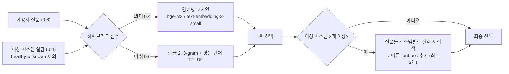

# 운영 인시던트 대응 AI 에이전트 — 상용 서비스 수준 개선

> SKALA AI Mini-Project · 과제 1번(Base AI Agent 개선) · 강주현
>
> 배포받은 `all_total_vue`(LangGraph + MCP + FastAPI + Vue 기반 운영 장애 진단 에이전트)를
> **"실제로 서비스할 수 있는가"** 라는 기준으로 점검하고, 찾아낸 약점 6가지를 고쳤습니다.
> 모든 개선은 **같은 입력으로 개선 전/후를 실측**했고, 개선 전 동작은 환경변수 하나로 재현할 수 있습니다.
>
> 원본 프로그램 설명서는 [doc/README.md](doc/README.md)에 그대로 있습니다.

---

## 1. 한눈에 보기

| # | 구분 | 무엇을 바꿨나 | 핵심 결과 (Before → After) | 개선 전 재현 |
|---|---|---|---|---|
| 1 | 추가 | **입력 가드레일** — 민감정보 마스킹, 빈 입력·프롬프트 인젝션 사전 차단 | 비밀번호·IP가 LLM·DB로 **그대로 전달 → 마스킹본만 전달** | – |
| 2 | 개선 | **오류 처리 표준화** — 내부 오류 비노출, 문의번호로 로그 추적 | `Internal Server Error` / 스트림 무응답 → **안내 문구 + 문의번호** | – |
| 3 | 개선 | **Runbook 선택: 키워드 규칙 → 하이브리드 RAG** | 정답 runbook 포함률 **33% → 94%** (18문항) | `RUNBOOK_RETRIEVER=keyword` |
| 4 | 개선 | **LLM 호출 동기 → 비동기** | 동시 3건 **18.9s → 6.8s**, 처리 중 `/health` **1917ms → 3ms** | `LLM_HTTP_MODE=sync` |
| 5 | 개선 | **답변 수치 근거 검증** — 수집 데이터에 없는 숫자 반려·재작성·경고 | 조작 재현 시 근거 없는 수치 **4/4 → 0/4**, 정상 답변 추가 비용 **0** | `GROUNDING_CHECK=off` |
| 6 | 추가 | **관리자 대시보드** — 토큰 인증, 성공률·지연·비용·오류·마스킹 현황 | 운영 지표 확인 수단 **없음 → 실시간 화면** | – |

단위 테스트 **58개** (`tests/`), 평가·벤치마크 스크립트 4종 (`eval/`, `bench/`)

---

## 2. 왜 이것들을 골랐나 — 원본 코드에서 실제로 확인한 약점

원본을 fake/OpenAI(키 없음) 백엔드로 직접 실행해 확인한 문제입니다.

| 확인한 문제 | 재현 방법 | 영향 |
|---|---|---|
| "비번 hunter2, IP 10.0.0.5" 입력이 마스킹 없이 LLM으로 전달되고 `session.db`에 원문 저장 | 질문 후 DB 조회 | 외부 LLM 서버·로컬 DB에 민감정보 잔존 |
| 빈 메시지·인젝션 문구도 LLM 호출 | 공백 전송 | 불필요한 과금 |
| LLM 실패 시 `/chat`은 `Internal Server Error` 텍스트만, 스트림은 이벤트 없이 끊기고 UI는 조용히 닫힘 | API 키 없이 요청 | 사용자는 이유를 모르고, 관리자는 추적 불가 |
| runbook을 **알림 문구의 키워드 규칙 순서**로 하나만 고름 | "web-01 디스크가 꽉 찼어요" → `db-down` | 사용자 질문이 무시되고, 복합 장애는 한쪽 runbook 누락 |
| `async def` 노드 안에서 **동기 `httpx.post`** 호출 | 코드 확인 + 벤치마크 | LLM 응답을 기다리는 동안 서버 전체 정지 |
| validate가 "30자 이상 + `1)` 포함"만 검사 | 코드 확인 (원본 주석에 "CPU 53.5% 조작" 실측 사례 기록) | 그럴듯한 거짓 숫자를 막지 못함 |
| 관리자가 볼 수 있는 운영 화면 없음 (LangSmith 트레이스뿐) | – | 서비스 전체 상태 파악 불가 |

---

## 3. 개선 상세

### 3-1. 입력 가드레일 — `agent/guardrails.py`

LLM을 호출하기 **전**에 코드로 거르는 방어선입니다. 프롬프트로 "민감정보를 출력하지 마라"고 해도
LLM이 지킨다는 보장이 없고, 한 번 외부 API로 넘어간 데이터는 되돌릴 수 없기 때문입니다.

1. `validate_input` — 빈 값 / 1000자 초과 / 인젝션 패턴(한·영)은 **LLM 호출 없이 400 거절**
2. `mask_sensitive` — 비밀번호·API 키·JWT·Bearer·주민번호·카드·이메일·전화·IP 9종을 `[MASKED_*]`로 치환.
   **마스킹본만** LLM·`session.db`·LangSmith·지표 저장소로 간다
3. `filter_output` — LLM 응답(스트리밍 토큰 포함)에도 같은 필터를 적용

```
입력: 비번은 hunter2고 서버 IP는 10.0.0.5인데 log-service 디스크 장애 진단해줘
LLM:  비번은 [MASKED_PASSWORD]고 서버 IP는 [MASKED_IP]인데 log-service 디스크 장애 진단해줘
```

### 3-2. 오류 처리 표준화 — `agent/errors.py`

- 모든 실패를 `{"error": {"code", "message", "error_id"}}` 하나의 형태로 반환
- 사용자에게는 원인 범주와 다음 행동만 ("잠시 후 다시 시도"), 내부 사정(API 키 누락·요금 한도·스택트레이스)은 숨김
- 같은 `error_id`로 서버 로그에 전체 스택트레이스를 남겨 관리자가 추적
- 401→`LLM_AUTH`, 429→`LLM_RATE_LIMIT`, 타임아웃→`TIMEOUT`, 연결 실패→`LLM_UNAVAILABLE` (LangGraph가 감싼 예외도 원인까지 추적)
- **SSE 스트림은 200으로 열고 `Error` 이벤트로 실패를 전달** — 브라우저 `EventSource`는 4xx/5xx 본문을 읽지 못하기 때문
- 화면: 빨간 말풍선 + 문의번호, 백엔드가 꺼지면 프록시가 503 안내

### 3-3. Runbook 선택 하이브리드 RAG — `agent/runbook_retriever.py`



- 서버 기동 시 runbook 6종을 **1회 임베딩**(Wave 1 싱글턴 원칙), `SupervisorDeps`로 그래프에 **의존성 주입**
- 임베딩을 쓸 수 없으면(Ollama 미기동 등) **어휘 검색으로 자동 대체** — 검색이 멈추지 않음
- 후보별 점수가 이벤트·LangSmith(`select_runbooks`)에 남아 "왜 이 runbook인지" 추적 가능

**평가** (`eval/runbook_eval.py`, 정답을 붙인 18문항 `eval/runbook_cases.json`, bge-m3):

| 방식 | Top-1 정확도 | 정답 전부 포함률 | 평균 선택 수 |
|---|---|---|---|
| keyword (개선 전) | 44% (8/18) | 33% (6/18) | 1.00 |
| 어휘 검색만 | 83% (15/18) | 83% (15/18) | 1.28 |
| **하이브리드 (의미 0.4)** | 78% (14/18) | **94% (17/18)** | 1.33 |

의미 비중 탐색 (`--sweep`): 0.0→83%, **0.2~0.5→94% (평탄한 최고 구간)**, 0.6~0.7→89%, 0.85~1.0→83%.
0.6 이상에서는 "응답·지연·타임아웃·커넥션 풀"을 모두 담은 `high-latency` 문서로 답이 쏠렸습니다(오답 3→5건).
→ 평탄 구간의 가운데이면서 평균 선택 수가 가장 적은 **0.4** 를 채택.

**주 지표를 Top-1이 아닌 "정답 전부 포함률"로 둔 이유**: 선택된 runbook은 순위와 무관하게 **모두** 답변 작성 단계에
전달되므로, 정답이 2순위에 있어도 답변은 올바르지만 빠지면 해당 절차가 통째로 사라집니다.

### 3-4. LLM 호출 비동기화 — `agent/llm_http.py`

- 공용 `httpx.AsyncClient` 하나로 모든 LLM·임베딩 호출을 `await` (연결 재사용)
- ollama/openai/fake 백엔드의 `route·plan·analyze`를 `async`로, 그래프 노드에서 `await`
- **벤치마크** (`sh/run_bench.sh`): 호출당 2초로 고정한 가짜 OpenAI 서버(`bench/mock_llm_server.py`)에 동시 3건

| 항목 | sync (개선 전) | async (개선 후) |
|---|---|---|
| LLM 처리 중 `/health` 최대 응답 | 1917 ms | **3 ms** |
| 동시 3건 전체 소요 | 18.92 s | **6.82 s** |
| 가장 늦게 받은 사람 | 18.92 s | **6.82 s** |

해석: 요청 1건 = LLM 3회. 개선 전엔 3건×3회 = 9회가 서버 전체에서 한 줄로 처리(≈18s),
개선 후엔 요청들이 동시에 진행(≈3×2s+α).

### 3-5. 답변 수치 근거 검증 — `agent/grounding.py`

- 답변에서 **주장성 수치**(소수·단위·10 초과)만 추출 → LLM이 **실제로 받은 프롬프트**·수집 데이터와 대조 (반올림 인용 허용)
- 근거 없는 수치가 있으면 **그 숫자를 짚어** 반려 → 재작성. 3회 후에도 남으면 답변 끝에 **"⚠️ 확인 필요"** 경고
- LLM에게 다시 묻지 않는 **결정론적 코드 검증** (원본의 gate·replan과 같은 설계 원칙)

**평가** (`eval/grounding_eval.py`, 같은 문항을 off→on으로 실행):

| 실행 | 장애 답변 | 근거 없는 수치 (off → on) | 검수 중 차단 | 평균 검수 (off / on) |
|---|---|---|---|---|
| 가짜 LLM 조작 모드 | 4 | **4/4 → 0/4** | 8개 | 1.00 / 2.00 |
| qwen3:8b | 6 | 0/6 → 0/6 | 0 | 1.00 / 1.00 |
| qwen3:0.6b (작성까지) | 17 | 0/17 → 0/17 | 0 | 1.41 / 1.29 |

**정직한 결론**: 이 18문항에서는 실모델이 숫자를 지어내지 않았습니다(사실이 적고 프롬프트에 구조화돼 있음).
따라서 이 개선은 성능 향상이 아니라 **"정상 답변엔 비용 0, 조작이 생기면 차단하는 안전망"** 입니다.
또한 첫 실모델 평가에서 **검증기 자신의 거짓 양성**("알림 0건"을 근거 없는 수치로 오판 → 정상 답변 2회 반려, 100초)을
발견해 고쳤습니다 → [eval/grounding_results_20261020_1511.md](eval/grounding_results_20261020_1511.md)

### 3-6. 관리자 대시보드 — `agent/metrics_store.py`, `admin.html`

- 모든 요청을 성공/정책 거절/오류로 SQLite에 기록 — 질문은 **마스킹본만**, 거절된 요청은 원문을 저장하지 않음
- `/admin/metrics`, `/admin/requests` — `.env`의 `ADMIN_TOKEN`이 맞아야 열림 (미설정 시 API 비활성, 타이밍 공격에 안전한 비교)
- `http://localhost:8600/admin` — KPI(성공률·p95·비용·거절·오류·마스킹·근거 경고), 시간대별 요청, 오류 코드, runbook 분포, 최근 요청, 현재 설정 배지. 5초 자동 갱신
- 성공률에서 **정책 거절은 실패로 세지 않음** (인젝션 차단은 장애가 아니라 정상 방어)
- 역할 분담: LangSmith = 요청 한 건의 내부 흐름(트레이스) / 대시보드 = 서비스 전체 운영 상태

---

## 4. 최종 검증 — 실제 OpenAI API (`sh/verify_openai.sh`)

gpt-4o-mini(분류·계획) + gpt-4o(답변 작성) + text-embedding-3-small, 2026-10-21 실행.
결과 원본: [eval/scenario_openai_20261021_0928.md](eval/scenario_openai_20261021_0928.md),
[eval/results_20261021_0928.md](eval/results_20261021_0928.md), [eval/grounding_results_20261021_0929.md](eval/grounding_results_20261021_0929.md)

| 시나리오 | 결과 | 선택된 runbook (하이브리드) | 마스킹 | 응답 | 비용 |
|---|---|---|---|---|---|
| 정상 장애 진단 | 성공 | high-latency | – | 6.5s | $0.0032 |
| 민감정보 포함 질문 | 성공 | disk-full | PASSWORD, IP | 5.0s | $0.0029 |
| 복합 장애 (2개 시스템) | 성공 | memory-leak, cpu-spike | – | 8.0s | $0.0049 |
| 증상 없이 "상태 확인해줘" | 성공 | db-down, network-timeout (정답은 2순위) | – | 5.2s | $0.0036 |
| 프롬프트 인젝션 | 400 거절 (LLM 호출 0) | – | – | 0.0s | $0 |
| 일반 대화 | 성공 (chat 직행) | – | – | 1.7s | $0.0000 |

- **runbook 정확도 (OpenAI 임베딩)**: Top-1 78% · 정답 전부 포함률 **94%** — bge-m3로 정한 가중치 0.4가 다른 임베딩 모델에서도 같은 결과를 내, 같은 문항으로 튜닝한 데 따른 과적합 우려를 일부 덜어 줌
- **근거 검증 6문항**: gpt-4o도 수치 조작 0건, 재작성 0회 (평균 응답 5.4s / 5.2s)
- 단위 테스트 58 passed, 6건 총 비용 $0.0146
- 첫 실행은 `.env` 설정 실수로 키가 거부됐는데, 이때도 사용자에게 `LLM_AUTH` 안내 + runbook 검색 어휘 모드 자동 전환이 동작함 → [eval/scenario_openai_20261021_0923.md](eval/scenario_openai_20261021_0923.md)

## 5. 평가 항목별 기술 요소

| 기술 요소 | 이 프로젝트에서 |
|---|---|
| RAG | runbook 하이브리드 검색 (임베딩 + 어휘), 가중치 sweep 실측 |
| MCP | 원본의 ops/docs MCP 서버를 그대로 사용 (monitoring Tool, runbook Resource, 진단 Prompt) |
| Multi-Agent / LangGraph | 원본 supervisor 그래프 유지, validate·finalize·replan_check 노드 확장 |
| 의존성 주입 | `SupervisorDeps.runbook_retriever`, 가짜 임베더·가짜 LLM으로 테스트 교체 |
| LangSmith | `select_runbooks` 등 신규 단계 `@traceable`, 마스킹본만 기록 |
| 모듈화 | 기능별 신규 모듈 6개 (`guardrails`, `errors`, `runbook_retriever`, `llm_http`, `grounding`, `metrics_store`) |
| 단위 테스트 | 58개 — 한글 조사 경계·거짓 양성 같은 **실제로 겪은 버그의 회귀 테스트** 포함 |
| 재현 가능한 비교 | 개선 전 동작을 환경변수로 복원 (`RUNBOOK_RETRIEVER`, `LLM_HTTP_MODE`, `GROUNDING_CHECK`) |

---

## 6. 한계와 트레이드오프

개선이 새로 만든 약점입니다.

| 개선 | 새로 생긴 약점 / 트레이드오프 |
|---|---|
| 가드레일 | 정규식 기반이라 **새로운 형식(신규 키 접두사 등)은 놓치고**, 인젝션은 표현을 바꾸면 우회 가능. IP를 가리면 LLM이 진단에 쓸 정보도 함께 사라짐 |
| 오류 처리 | 사용자 메시지가 일반적이라 스스로 해결할 단서가 적음. `error_id` 추적은 서버 로그 접근이 전제 |
| 하이브리드 RAG | 요청마다 **임베딩 호출 2~4회 추가**(지연·OpenAI 사용 시 비용). runbook을 메모리에 들고 있어 문서가 수천 개면 벡터 DB 필요. **가중치를 같은 18문항으로 튜닝 → 과적합 가능성** (단, OpenAI 임베딩에서도 동일하게 94%). 증상 없이 "상태 확인해줘"처럼 묻는 질문은 1순위가 흔들림(정답은 2순위로 포함). 임베딩이 꺼진 어휘 검색 모드는 영어 알림 시스템에 약함 |
| 비동기화 | 서버는 더 이상 막히지 않지만 **Ollama는 모델이 요청을 순차 처리**해 실제 총 시간 이득은 작음. MCP 클라이언트의 lock은 여전히 MCP 호출을 직렬화 |
| 근거 검증 | **숫자만** 검사(문장 형태의 거짓은 못 잡음). 수집값으로 계산한 파생 수치(2.4s−1.0s=1.4s)도 반려됨. 실모델에서 효과를 수치로 입증하지 못함 |
| 대시보드 | 단일 공유 토큰(사용자별 권한·감사 로그 없음). 지표가 `session.db`와 같은 파일에 **보존 기한 없이 누적**되고 집계를 Python에서 매번 계산 → 데이터가 커지면 느려짐. 비용은 가상 단가 |

## 7. 추가 개선 방향

- **LLM 장애 시 자동 대체**: OpenAI 실패가 이어지면 Ollama로 전환하는 서킷 브레이커 (가짜 LLM 서버로 실패 주입 실측 가능)
- **조치 실행 + 사람 승인(HITL)**: 재시작·롤백을 MCP Tool로 만들고 LangGraph `interrupt()`로 승인 후 실행, 실행 후 모니터링 재조회
- **평가 데이터 분리**: 튜닝용/검증용 문항을 나눠 과적합 없이 재측정, LLM-as-judge로 답변 품질 채점
- **운영 강화**: 지표 보존 기한·별도 DB, 관리자 계정·권한, GitHub Actions로 테스트 자동화

---

## 8. 실행 방법

원본과 동일하게 `bash sh/setup_venv.sh` → `bash sh/setup_ollama.sh` → 서버 → 프론트 순서입니다
(자세한 내용은 [doc/README.md](doc/README.md)). 추가된 것:

```bash
cp .env.example .env            # OPENAI_API_KEY, LANGCHAIN_API_KEY, ADMIN_TOKEN 입력
ollama pull bge-m3              # 하이브리드 RAG용 다국어 임베딩 모델

bash sh/run_agent_ollma.sh      # 백엔드 (로컬)  — 또는 sh/run_agent_openai.sh (과금)
bash sh/run_frontend.sh         # http://localhost:8600 채팅, http://localhost:8600/admin 대시보드
```

| 명령 | 내용 |
|---|---|
| `python -m pytest tests -q` | 단위 테스트 58개 |
| `python eval/runbook_eval.py [--sweep]` | runbook 정확도 keyword/어휘/하이브리드 비교, 의미 비중 탐색 |
| `bash sh/run_bench.sh` | 동기 vs 비동기 동시성 벤치마크 (가짜 LLM, 과금 없음) |
| `python eval/grounding_eval.py [--limit N]` | 수치 근거 검증 off/on 비교 |
| `bash sh/verify_openai.sh` | **OpenAI 최종 검증** — 테스트·정확도·대표 시나리오·관리자 지표·근거 검증 일괄 실행 (과금) |

**개선 전 동작 재현용 환경변수**

| 변수 | 값 | 효과 |
|---|---|---|
| `RUNBOOK_RETRIEVER` | `keyword` | 원본 키워드 규칙으로 runbook 선택 |
| `LLM_HTTP_MODE` | `sync` | 원본처럼 동기 HTTP 호출 |
| `GROUNDING_CHECK` | `off` | 형식만 검사 |
| `RUNBOOK_SEMANTIC_WEIGHT` | `0.0~1.0` | 의미 점수 비중 (기본 0.4) |
| `EMBED_BACKEND` | `ollama`/`openai`/`none` | 임베딩 제공자 (기본: LLM 백엔드를 따름) |

## 9. 추가·변경 파일

```
agent/guardrails.py        입력 검증·민감정보 마스킹·출력 필터            (신규)
agent/errors.py            예외 → 사용자 메시지 + error_id               (신규)
agent/runbook_retriever.py 하이브리드 runbook 검색                       (신규)
agent/llm_http.py          공용 비동기 HTTP 클라이언트                   (신규)
agent/grounding.py         답변 수치 근거 검증                           (신규)
agent/metrics_store.py     요청 단위 운영 지표 저장소                     (신규)
admin.html                 관리자 대시보드 화면                          (신규)
agent/graph.py             runbook 선택·validate·finalize 확장, LLM await (수정)
agent/{ollama,openai,fake}_llm.py  비동기화, OPENAI_BASE_URL            (수정)
server.py                  가드레일·오류 처리·지표 기록·관리자 API        (수정)
web_chat.html              오류 말풍선, 마스킹·검수·검색 방식 표시        (수정)
web_demo_server.py         백엔드 다운 안내, 관리자 페이지·API 중계       (수정)
tests/                     단위 테스트 58개                              (신규)
eval/, bench/, sh/run_bench.sh, sh/verify_openai.sh  평가·벤치마크       (신규)
```
